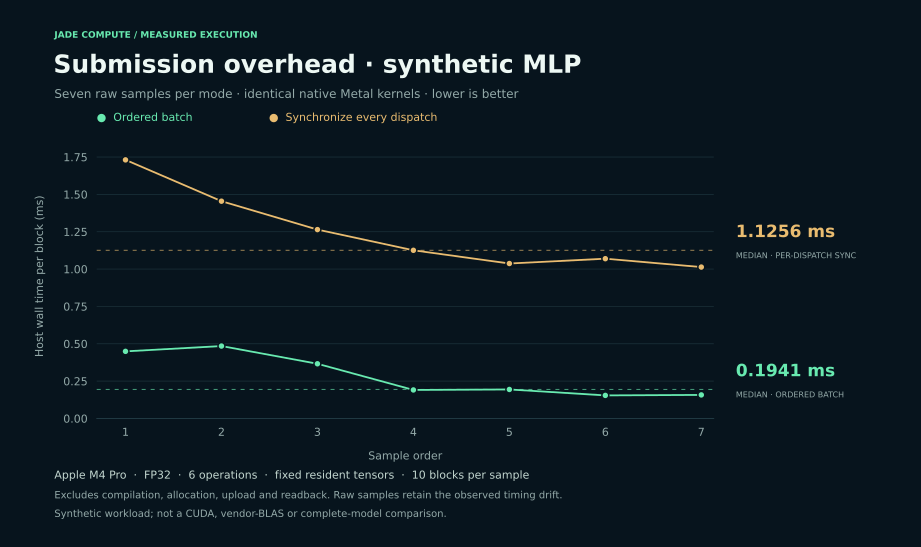

<p align="center">
  
</p>

<p align="center">
  <a href="https://github.com/demier-demier/jade-compute/actions/workflows/ci.yml"></a>
  
  
  
  
</p>

<p align="center">
  <a href="#reproduce-the-metal-experiment">Reproduction</a> ·
  <a href="reports/NATIVE_RESULTS.md">Measured results</a> ·
  <a href="docs/ROADMAP.md">Roadmap</a> ·
  <a href="docs/COMMERCIAL.md">Commercial direction</a> ·
  <a href="https://www.linkedin.com/in/bernardo-demier-3176001ab/">Contact Bernardo</a> ·
  <a href="reports/RESULTADOS_PREVIOS_PT.md">Português</a>
</p>

## One compute description. Native GPU paths. Inspectable evidence.

Jade Compute explores a Rust compiler and runtime for GPU compute across Apple
Metal and Iluvatar CoreX. Describe an operation once, inspect the generated
device source, and validate its output against an independent reference.

**This repository is the public research prototype.** It demonstrates the
engineering approach behind a proposed commercial stack for GPU manufacturers
and AI teams. Production integration, hardware qualification and support are
future product goals. [Discuss an evaluation or partnership →](docs/COMMERCIAL.md#contact)

Today, native Metal executes on an Apple M4 Pro. CoreX source and adapters are
prepared but have not been built with the vendor SDK or run on an Iluvatar GPU.
Jade does not yet translate CUDA C++ or PTX, replace the CUDA ecosystem, run a
complete LLM, or demonstrate a speed advantage over NVIDIA.

## What you can inspect

- **A checked compiler path.** A Rust operation and expression IR generates MSL
  and CoreX C++; the same fused expression can target both source languages.
- **A native runtime.** Owned buffers, exact transfers, pipeline reuse, resource
  validation and ordered command batching.
- **AI building blocks.** GEMM, RMSNorm, SwiGLU, Softmax, AXPY, Add and fused
  elementwise expressions; a six-operation synthetic residual MLP.
- **Evidence alongside code.** Independent FP64 oracles, raw timing samples,
  generated kernels, source hashes and explicit measurement boundaries.


| Path | Current status | Evidence / next step |
| :--- | :--- | :--- |
| Native Apple Metal | **Executed locally** on Apple M4 Pro | 19 numerical cases, 6,456 checked outputs; synthetic MLP validated |
| Iluvatar CoreX | **Source prepared**; SDK build and device execution pending | Qualify exact GPU, SDK, driver and compiler target with a hardware partner |
| Portable wgpu | Earlier GEMM workbench; tested on Metal | [Historical measurements](reports/LOCAL_RESULTS.md); Vulkan requires a compatible driver |
| Other Chinese accelerators | Research only; no backend claimed | [Hardware landscape and official sources](docs/HARDWARE.md) |

Host CI checks Rust and CPU behavior on Linux and macOS. It does **not** certify
GPU execution or CoreX compatibility.

## Reproduce the Metal experiment

The recorded GPU results use **Apple M4 Pro / macOS**. You need a Metal-capable
Mac, Apple command-line developer tools and Rust through
[rustup](https://rustup.rs/). The repository pins Rust 1.90.0. These commands
document reproduction; they do not grant a separate license. See
[licensing status](RIGHTS.md) and contact the maintainer about evaluation or reuse.

```sh
git clone https://github.com/demier-demier/jade-compute.git
cd jade-compute

cargo build --release --locked --bins
mkdir -p target/demo

./target/release/jade-runtime info
./target/release/jade-runtime verify --report target/demo/verify.json
./target/release/jade-runtime mlp --report target/demo/mlp.json
```

The commands query the device, validate every output in the native conformance
suite, then execute and measure a synthetic MLP block. Reports go into `target/`
so a new run preserves the published evidence. These are generated weights,
not a trained model or token-serving benchmark.

### Generate both native sources

The included [expression example](examples/kernels/fused_axpy_relu.json)
describes `max(2.5 × x + y, 0)` for 257 elements. Source emission needs neither
the CoreX SDK nor an Iluvatar board:

```sh
./target/release/jade-runtime emit \
  --spec examples/kernels/fused_axpy_relu.json --target metal \
  --output target/demo/fused.metal

./target/release/jade-runtime emit \
  --spec examples/kernels/fused_axpy_relu.json --target corex \
  --output target/demo/fused.cu
```

Emission is not device compilation or execution. For real CoreX bring-up, use
the [native runtime guide](docs/NATIVE_RUNTIME.md#native-corex) with the exact
architecture and SDK supplied by Iluvatar. The Rust host language alone does
not make a mathematical kernel faster.

## A measured local experiment

How much does submission strategy matter for a small, resident MLP block?
This experiment executes the **same six kernels** either in an ordered batch
or with a synchronization after every dispatch.



| Apple M4 Pro · FP32 · batch 8 / width 128 / hidden 256 | Result |
| :--- | ---: |
| Ordered batch, median host time per block | **0.1941 ms** |
| Synchronize each dispatch, median host time per block | **1.1256 ms** |
| Ratio within this experiment | **5.80×** |
| Maximum absolute output error vs FP64 reference | **2.01 × 10⁻⁷** |

Seven alternating rounds, ten block repeats per round, resident buffers. Host
time includes encoding, submission and completion; it excludes compilation,
allocation, initial upload and readback. Samples vary substantially and are
shown individually. The baseline intentionally synchronizes frequently.

A [second reproduction before publication](reports/native-metal-mlp-reproduction.json)
measured **0.2094 ms vs 0.9312 ms (4.45×)** on the same Mac. The earlier run
plotted above is preserved; the ratio is not a stable performance guarantee.

**This is a scheduling comparison, not a CUDA, NVIDIA, MPS, vendor BLAS or
full-model speedup.** No Chinese-GPU performance result is claimed.

[Methodology and limitations](reports/NATIVE_RESULTS.md) ·
[Raw samples](reports/native-metal-mlp.json) ·
[Correctness report](reports/native-metal-verify.json) ·
[Recorded provenance](reports/native-manifest.json)

## Explore the engineering

| Start here | What it answers |
| :--- | :--- |
| [Native runtime and compiler](docs/NATIVE_RUNTIME.md) | How memory, compilation and execution work |
| [CUDA reconstruction map](docs/CUDA_RECONSTRUCTION.md) | Which ecosystem layers exist and which are still missing |
| [Hardware landscape](docs/HARDWARE.md) | Chinese accelerator families, software stacks and evidence |
| [Roadmap](docs/ROADMAP.md) | Milestones with concrete validation gates |
| [Commercial direction](docs/COMMERCIAL.md) | Intended product, evaluation scope and contact |
| [FAQ](docs/FAQ.md) | Compatibility, performance, Rust and licensing |
| [Changelog](CHANGELOG.md) | What is included in the research preview |

Em português: [resultados prévios](reports/RESULTADOS_PREVIOS_PT.md) ·
[reconstrução e limites](docs/RECONSTRUCAO_CUDA_PT.md) ·
[plano de desenvolvimento](docs/PLANO_PRODUTO_PT.md).

## Help validate the next architecture

The most useful next contribution is **reproducible evidence from real
hardware**. Iluvatar access, SDK/compiler details, independent benchmark
reproduction and numerical counterexamples can all move the project forward.

- [Report hardware validation](https://github.com/demier-demier/jade-compute/issues/new/choose)
- [Discuss the architecture](https://github.com/demier-demier/jade-compute/discussions)
- [Propose a commercial evaluation](docs/COMMERCIAL.md#contact)

Read [contribution guidance](CONTRIBUTING.md) before sending code; contribution
and licensing terms need to be agreed first. For vulnerabilities, use the
[private reporting channel](SECURITY.md).

## Public prototype, commercial ambition

Maintained by [Bernardo Demier](https://www.linkedin.com/in/bernardo-demier-3176001ab/). This public
repository presents a research prototype and its measured results. The proposed
commercial product would add selected workload integration, optimization,
hardware qualification and support under separately agreed terms.

**GPU manufacturers, AI teams and potential partners:**
[contact Bernardo on LinkedIn](https://www.linkedin.com/in/bernardo-demier-3176001ab/)
to discuss a scoped evaluation, co-development or future commercial licensing.

**No open-source license is granted for Jade's project-authored material.**
GitHub's viewing and forking terms and third-party licenses still apply.
See [rights and licensing status](RIGHTS.md), and
[contact the maintainer](docs/COMMERCIAL.md#contact) about evaluation, integration
or commercial permissions. No vendor affiliation or endorsement is claimed.
