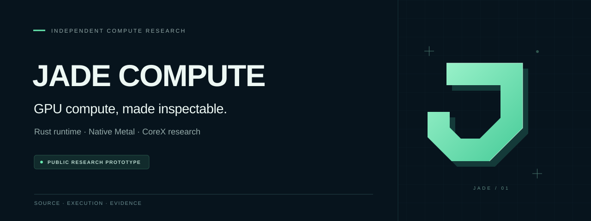
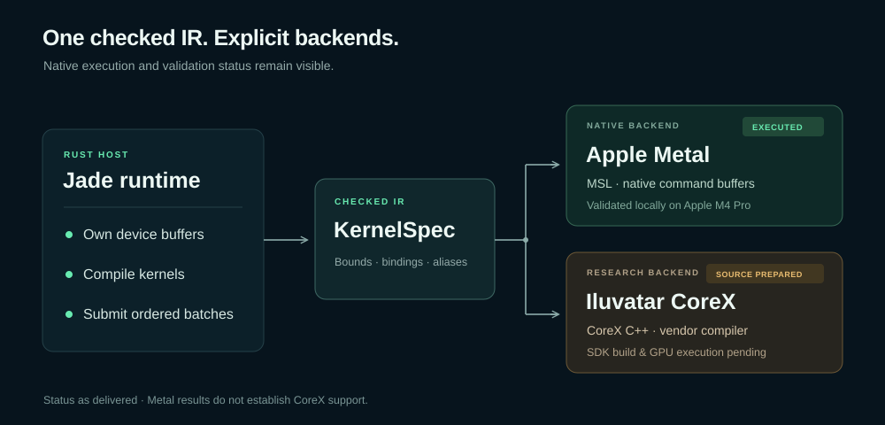
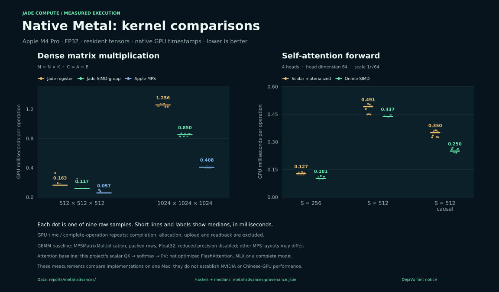

<p align="center">
  
</p>

<p align="center">
  <a href="https://github.com/demier-demier/jade-compute/actions/workflows/ci.yml"></a>
  
  
  
  
</p>

<p align="center">
  <a href="#reproduce-the-metal-experiment">Reproduction</a> ·
  <a href="reports/METAL_ADVANCES.md">Measured results</a> ·
  <a href="docs/ROADMAP.md">Roadmap</a> ·
  <a href="docs/COMMERCIAL.md">Commercial direction</a> ·
  <a href="https://www.linkedin.com/in/bernardo-demier-3176001ab/">Contact Bernardo</a> ·
  <a href="reports/AVANCOS_METAL_PT.md">Português</a>
</p>

## One compute description. Native GPU paths. Inspectable evidence.

Jade Compute explores a Rust compiler and runtime for GPU compute across Apple
Metal and Iluvatar CoreX. Describe an operation once, inspect the generated
device source, and validate its output against an independent reference.

**This repository is the public research prototype.** It demonstrates the
engineering approach behind a proposed commercial stack for GPU manufacturers
and AI teams. Production integration, hardware qualification and support are
future product goals. [Discuss an evaluation or partnership →](docs/COMMERCIAL.md#contact)

Today, native Metal executes on an Apple M4 Pro. CoreX source and adapters are
prepared but have not been built with the vendor SDK or run on an Iluvatar GPU.
Jade does not yet translate CUDA C++ or PTX, replace the CUDA ecosystem, run a
complete LLM, or demonstrate a speed advantage over NVIDIA.

## What you can inspect

- **A checked compiler path.** A Rust operation and expression IR generates MSL
  and CoreX C++; the same fused expression can target both source languages.
- **A native runtime.** Owned buffers, exact transfers, pipeline reuse, resource
  validation and ordered command batching.
- **Native matrix acceleration.** FP32 SIMD-group GEMM and explicit Apple MPS
  library operations mixed with custom kernels in one ordered batch.
- **AI building blocks.** Causal/noncausal online self-attention, RMSNorm, SwiGLU,
  Softmax and fused expressions; a synthetic residual MLP with selectable GEMM.
- **Evidence alongside code.** Independent FP64 oracles, raw timing samples,
  generated kernels, source hashes and explicit measurement boundaries.



| Path | Current status | Evidence / next step |
| :--- | :--- | :--- |
| Native Apple Metal | **Executed locally** on Apple M4 Pro | SIMD matrices, mixed MPS/shader batches and forward attention; [62 new case/implementation checks](reports/METAL_ADVANCES.md) |
| Iluvatar CoreX | **Source prepared**; SDK build and device execution pending | Qualify exact GPU, SDK, driver and compiler target with a hardware partner |
| Portable wgpu | Earlier GEMM workbench; tested on Metal | [Historical measurements](reports/LOCAL_RESULTS.md); Vulkan requires a compatible driver |
| Other Chinese accelerators | Research only; no backend claimed | [Hardware landscape and official sources](docs/HARDWARE.md) |

Host CI checks Rust and CPU behavior on Linux and macOS. It does **not** certify
GPU execution or CoreX compatibility.

## Reproduce the Metal experiment

The recorded GPU results use **Apple M4 Pro / macOS**. You need an Apple Silicon
Mac with Apple7-or-newer GPU capabilities, Apple developer tools and Rust through
[rustup](https://rustup.rs/). The repository pins Rust 1.90.0. These commands
document reproduction; they do not grant a separate license. See
[licensing status](RIGHTS.md) and contact the maintainer about evaluation or reuse.

```sh
git clone https://github.com/demier-demier/jade-compute.git
cd jade-compute

cargo build --release --locked --bins
mkdir -p target/demo

./target/release/jade-runtime info
./target/release/jade-runtime metal-verify --report target/demo/verify.json
./target/release/jade-runtime metal-gemm --report target/demo/gemm.json
./target/release/jade-runtime metal-attention --causal --report target/demo/attention.json
```

The commands query the device, validate every output in the native conformance
suite, then compare GEMM and attention implementations on resident tensors. Reports
go into `target/` to preserve the published evidence. The runtime checks GPU
capabilities and rejects unsupported SIMD paths. These are synthetic operator
experiments, not a trained model or token-serving benchmark.

For a six-operation AI block using MPS matrix multiplication alongside Jade
kernels, run `./target/release/jade-runtime mlp --mps-gemm`. Use `--simd-gemm` for Jade's custom
SIMD-group path. [Full contracts and reproduction guide →](docs/METAL_ADVANCES.md)

### Generate both native sources

The included [expression example](examples/kernels/fused_axpy_relu.json)
describes `max(2.5 × x + y, 0)` for 257 elements. Source emission needs neither
the CoreX SDK nor an Iluvatar board:

```sh
./target/release/jade-runtime emit \
  --spec examples/kernels/fused_axpy_relu.json --target metal \
  --output target/demo/fused.metal

./target/release/jade-runtime emit \
  --spec examples/kernels/fused_axpy_relu.json --target corex \
  --output target/demo/fused.cu
```

Emission is not device compilation or execution. For real CoreX bring-up, use
the [native runtime guide](docs/NATIVE_RUNTIME.md#native-corex) with the exact
architecture and SDK supplied by Iluvatar. The Rust host language alone does
not make a mathematical kernel faster.

## Native Metal: measured progress

The new preview adds cooperative matrix operations, SIMD reductions, online
self-attention and mixed MPS/custom-kernel batches. It implements these concepts
with **public Apple APIs**. It does not emulate NVIDIA Tensor Cores, translate
WMMA/PTX or reproduce the complete FlashAttention implementation.



**Median GPU milliseconds per operation · FP32 · Apple M4 Pro · lower is better**

| GEMM shape | Previous Jade | New Jade SIMD | Apple MPS, packed rows |
| :--- | ---: | ---: | ---: |
| 512 × 512 × 512 | 0.16295 | **0.11692** | **0.05726** |
| 1024 × 1024 × 1024 | 1.25620 | **0.85020** | **0.40820** |

The custom 1024³ kernel is **1.48× faster than the previous Jade kernel** in
this run. Apple's MPS remains faster; the runtime can now use it directly in
mixed operation batches. This is an Apple-library integration, not a claim
that Jade invented or outperformed MPS.

Causal self-attention at **4 heads × 512 positions × 64 channels** measured
**0.34967 → 0.25011 ms (1.40×)** against this project's scalar materialized
reference. The online path avoids **8 MiB of score/probability scratch** for
that shape. This is algorithm-level buffer accounting, not measured peak memory.
The comparator is not optimized FlashAttention, MLX or a full model.

Nine interleaved samples per variant, ten repeats per sample, after warmup.
GPU timing covers the complete command buffer; compile, allocation, transfers
and CPU references are excluded. Raw host timings are also retained. All tested
shapes, including vector and ragged cases, are in the report. No NVIDIA or
Chinese-GPU speedup is claimed.

**Validation:** 62 case/implementation checks covering 509,710 output values,
including FP32 precision probes; 12 host tests and 3 explicit GPU tests passed.
Metal API and shader validation were enabled for correctness runs and disabled
for timings. Both synthetic MLP modes validated all 32,768 outputs.

[Measured results and limitations](reports/METAL_ADVANCES.md) ·
[Raw data and source hashes](reports/metal-advances/manifest.json) ·
[Native implementation guide](docs/METAL_ADVANCES.md) ·
[Earlier submission-overhead experiment](reports/NATIVE_RESULTS.md)

## Explore the engineering

| Start here | What it answers |
| :--- | :--- |
| [Native Metal advances](docs/METAL_ADVANCES.md) | SIMD matrices, online attention and mixed MPS execution |
| [Native runtime and compiler](docs/NATIVE_RUNTIME.md) | How memory, compilation and execution work |
| [CUDA reconstruction map](docs/CUDA_RECONSTRUCTION.md) | Which ecosystem layers exist and which are still missing |
| [Hardware landscape](docs/HARDWARE.md) | Chinese accelerator families, software stacks and evidence |
| [Roadmap](docs/ROADMAP.md) | Milestones with concrete validation gates |
| [Commercial direction](docs/COMMERCIAL.md) | Intended product, evaluation scope and contact |
| [FAQ](docs/FAQ.md) | Compatibility, performance, Rust and licensing |
| [Changelog](CHANGELOG.md) | What is included in the research preview |

Em português: [avanços no Metal](reports/AVANCOS_METAL_PT.md) ·
[resultados iniciais](reports/RESULTADOS_PREVIOS_PT.md) ·
[reconstrução e limites](docs/RECONSTRUCAO_CUDA_PT.md) ·
[plano de desenvolvimento](docs/PLANO_PRODUTO_PT.md).

## Help validate the next architecture

The most useful next contribution is **reproducible evidence from real
hardware**. Iluvatar access, SDK/compiler details, independent benchmark
reproduction and numerical counterexamples can all move the project forward.

- [Report hardware validation](https://github.com/demier-demier/jade-compute/issues/new/choose)
- [Discuss the architecture](https://github.com/demier-demier/jade-compute/discussions)
- [Propose a commercial evaluation](docs/COMMERCIAL.md#contact)

Read [contribution guidance](CONTRIBUTING.md) before sending code; contribution
and licensing terms need to be agreed first. For vulnerabilities, use the
[private reporting channel](SECURITY.md).

## Public prototype, commercial ambition

Maintained by [Bernardo Demier](https://www.linkedin.com/in/bernardo-demier-3176001ab/). This public
repository presents a research prototype and its measured results. The proposed
commercial product would add selected workload integration, optimization,
hardware qualification and support under separately agreed terms.

**GPU manufacturers, AI teams and potential partners:**
[contact Bernardo on LinkedIn](https://www.linkedin.com/in/bernardo-demier-3176001ab/)
to discuss a scoped evaluation, co-development or future commercial licensing.

**No open-source license is granted for Jade's project-authored material.**
GitHub's viewing and forking terms and third-party licenses still apply.
See [rights and licensing status](RIGHTS.md), and
[contact the maintainer](docs/COMMERCIAL.md#contact) about evaluation, integration
or commercial permissions. No vendor affiliation or endorsement is claimed.
